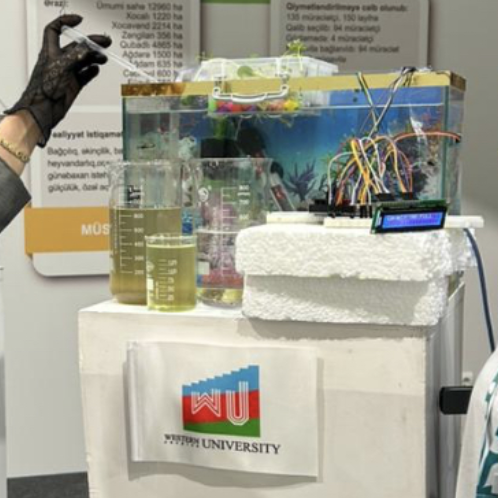

# 🌊 AquaMind AI — Official Web Application & GitHub Pages

[](https://aquamindai.github.io)
[](https://nextjs.org)
[](LICENSE)

> 🌐 **Live Website**: [https://aquamindai.github.io](https://aquamindai.github.io)  
> 🔒 **Core Enterprise Repository & Research Data (Private)**: [AquaMindAI/AquaMindAI](https://github.com/AquaMindAI/AquaMindAI)

> [!IMPORTANT]
> ### 🔒 Məlumatların Məxfiliyi və Giriş İcazəsi (Private Data & Access Request)
> **Bu layihənin əsas tədqiqat dataları, eksperimental telemetriya bazası, AI modelləri, mikrokontroller proqram təminatı və tam mənbə kodu (`AquaMindAI` monorepo) məxfidir (`Private`).**
>
> Akademik tədqiqat, elmi rəy (peer-review), tərəfdaşlıq və ya məxfi repozitoriyalara və datalara **giriş icazəsi (access)** əldə etmək istəyirsinizsə, rəsmi elektron poçt ünvanları vasitəsilə müraciət edə bilərsiniz:
> - 📧 **Əsas E-poçt:** [suleyman.hacizade1@gmail.com](mailto:suleyman.hacizade1@gmail.com)
> - 🎓 **Akademik E-poçt:** [suleyman.hacizade.232bioing@wcu.edu.az](mailto:suleyman.hacizade.232bioing@wcu.edu.az)

Welcome to the official frontend deployment repository of **AquaMind AI**, the intelligent closed-loop IoT and machine learning platform for precision aquaculture and circular aquaponics.



---

## 🌟 Key Features of the Web Interface

- **Live Multi-Pool Monitoring**: Real-time telemetry for Sturgeon (*Acipenser*), Nile Tilapia (*Oreochromis*), and Rainbow Trout (*Oncorhynchus*) recirculating loops.
- **Harmonic Diurnal Thermal Forecasts**: 1-hour, 3-hour, and 6-hour machine learning water temperature projections with dynamic confidence intervals.
- **Parametric Health & Risk Scoring**: Instant feedback on ecosystem stability ($S_{\text{health}}$ and $R_{\text{system}}$).
- **Interactive Failure Simulation**: Test critical conditions like `+8°C Thermal Spike` and `-45cm Water Leak` with instant alarm trigger and resolution.
- **Client-Side Reactive Telemetry Engine**: Operates reliably both as a standalone demo on GitHub Pages and when connected to live physical hardware via FastAPI.

---

## 🛠️ Local Development

```bash
# 1. Clone this repository
git clone https://github.com/AquaMindAI/AquaMindAI.github.io.git
cd AquaMindAI.github.io

# 2. Install dependencies
npm install

# 3. Start local development server
npm run dev
# Live at http://localhost:3000

# 4. Build and export static site
npm run build
```

---

## 📜 License

Licensed under the [Apache License, Version 2.0](LICENSE).  
Copyright © 2026 **AquaMind AI** / **Suleyman Hajizade**.
